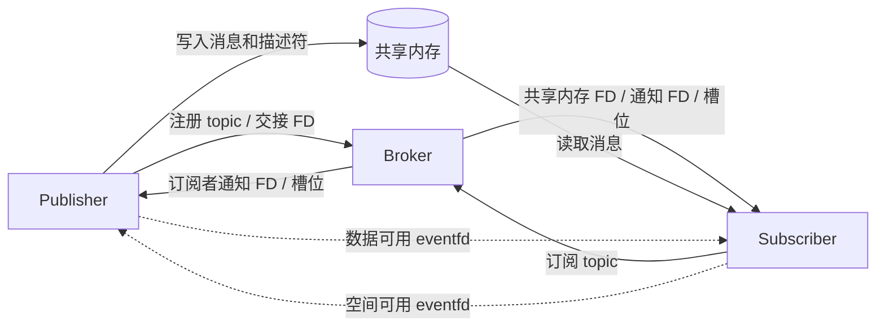

# DriveBus

## 下载项目

```bash
git clone https://github.com/chen-lyc/DriveBus.git
cd DriveBus
```

也可以在 [GitHub 仓库](https://github.com/chen-lyc/DriveBus) 页面选择 **Code → Download ZIP**，解压后进入项目目录。

## 快速上手

### 1. 准备环境并编译

项目依赖 Linux、支持 C++20 的 C++ 编译器、GNU Make 和 POSIX 线程库。使用了 `epoll_pwait2`，需要内核及 C 库提供对应支持。Ubuntu / Debian 可先安装：

```bash
sudo apt update
sudo apt install -y build-essential git
```

在项目根目录编译：

```bash
make -j2
```

自动创建 `build/` 目录，并将所有可执行文件生成到其中：

| 程序 | 用途 |
| --- | --- |
| `build/broker.out` | 管理 topic 注册、发布订阅关系及文件描述符交接 |
| `build/pub_node` | 同步发布样例，每秒向 `Camera` topic 发送一条文本消息 |
| `build/sub_node` | 同步订阅样例，接收并打印 `Camera` topic 的消息 |
| `build/broker-status` | 查询 broker 当前的注册和连接状态 |

强制重新编译可执行 `make rebuild`；单独编译样例可执行 `make pub_node sub_node`；清理这四个程序可执行 `make clean`。`build/` 已加入 Git 忽略规则。当前 Makefile 默认启用 `ENABLE_DEBUG_CHECKS`，所有参与通信的程序应使用相同的头文件和编译选项重新构建。

### 2. 启动 broker

打开终端一，在项目根目录运行：

```bash
./build/broker.out
```

broker 使用固定的 Unix socket 地址 `/tmp/broker.sock`。保持该终端运行，同一环境中运行一个 broker 实例即可。

### 3. 启动订阅样例

打开终端二，进入同一项目目录：

```bash
./build/sub_node
```

出现以下输出后，程序将等待消息：

```text
sub_node: waiting for Camera messages (Ctrl+C to stop)
```

### 4. 启动发布样例

打开终端三，进入同一项目目录：

```bash
./build/pub_node
```

发布端每次成功发布后输出：

```text
pub_node: publishing to Camera (Ctrl+C to stop)
published: Hello, DriveBus!
published: Hello, DriveBus!
```

订阅端对应输出：

```text
received: Hello, DriveBus!
received: Hello, DriveBus!
```

也可以传入自定义文本；包含空格时需加引号：

```bash
./build/pub_node "camera frame ready"
```

先停止原来的 `pub_node` 再运行上述命令。样例使用固定共享内存名称 `/drivebus_pub_node_camera`，运行多个发布端时需为每个实例设置不同的共享内存名称。

### 5. 查看状态并退出

另开终端执行：

```bash
./build/broker-status
```

状态快照包含已注册连接、角色、topic 路由及订阅槽位。验证多订阅者接收时，先停止 `pub_node`，再启动第二个 `./build/sub_node`，最后重新启动发布样例。

两个样例均支持 **Ctrl+C** 退出。演示结束时先退出发布端和订阅端，再退出 broker；样例退出后由对象析构释放相应资源。

发布端未连接到订阅者，或共享内存暂时没有可用空间时，会输出 `publish timeout` 并继续等待；订阅端等待超时会继续接收。详细日志位于运行目录下的 `logs/standalone/`；设置 `DRIVEBUS_RUN_ID` 环境变量后，日志写入 `logs/<运行标识>/`。

完整样例源码：[pub_node.cpp](pub_node.cpp) · [sub_node.cpp](sub_node.cpp)。

文档导航：[接口与使用样例](#接口与使用样例) · [完整使用指南](docs/usage.md) · [工作原理](#工作原理) · [当前配置与边界](#当前配置与边界)。

## 项目简介

DriveBus 是基于 **Linux / C++20** 的本机跨进程发布订阅通信项目，用于探索中间件中的共享内存传输、消息通知、资源所有权和连接生命周期管理。

发布者和订阅者按 `TopicId` 建立关联：broker 负责注册与资源交接，消息正文通过发布者创建的共享内存传递。当前提供 `Publisher`、`Subscriber` C++ 接口，以及可直接运行的发布、订阅和状态查询程序。

项目处于持续开发阶段，适合系统编程学习与通信机制实验。

## 主要功能

- **按 topic 发布订阅**：提供 `Camera`、`Lidar`、`VehicleState` 三个 topic；同一 topic 可关联多个发布者和订阅者。
- **共享内存数据通路**：每个发布者创建独立的 `SharedData`，通过描述符环和分档内存池传递消息。
- **事件通知**：使用 `eventfd` 通知数据与空间可用，通过 `epoll` 等待控制和数据事件。
- **同步与异步接口**：同步发布、订阅支持超时；异步发布返回完成凭据，异步订阅通过回调处理数据。
- **连接生命周期处理**：管理动态加入、断连通知、订阅槽位和未消费消息引用的回收。
- **运行状态与日志**：提供 `broker-status` 状态快照和按进程记录的日志。

## 工作原理



1. 发布者创建共享内存，通过 Unix domain `SOCK_SEQPACKET` 向 broker 注册 topic；文件描述符通过 `SCM_RIGHTS` 交接。
2. 订阅者注册 topic 列表，broker 建立与对应发布者的关联，分配订阅槽位并交接共享内存与通知 FD。
3. 发布者将正文和内部消息头写入内存池，写入 `{offset, len}` 描述符，再发布写下标并通知订阅者。
4. 订阅者读取消息、推进自己的读下标并清除引用位；最后一个持有者归还 chunk，并通知发布者空间可用。
5. 端点断连后，broker 通知关联端点清理相应的订阅关系或映射资源。

broker 处理控制消息；消息正文由发布端和订阅端通过共享内存交换。当前发布 API 会复制调用者的 payload，同步订阅返回自有的字节数组，接口使用方式见下文。

## 接口与使用样例

`pub_node` 和 `sub_node` 是同步模式的命令行样例。`pub_node` 支持 `[message]` 与 `--help`，`sub_node` 使用源码中配置的 topic 列表；异步模式、多 topic 和二进制数据通过 C++ API 使用。

### 选择收发模式

| 场景 | 创建模式 | 使用接口 | 返回或交付方式 |
| --- | --- | --- | --- |
| 同步发布 | `Publisher::SYNCHRONOUS` | `publish(payload, timeout)` | 成功时已写入共享内存；失败返回 `PublishError` |
| 异步发布 | `Publisher::ASYNCHRONOUS` | `publish(payload)` | 返回入队凭据，通过 `ticket.future` 获取最终状态 |
| 同步订阅 | `Subscriber::SYNCHRONOUS` | `subscribe(timeout)` | 返回自有的 `MessageBatch` 或 `SubscribeError` |
| 异步订阅 | `Subscriber::ASYNCHRONOUS` | 创建时传入回调 | 后台线程调用 `callback(char *, size_t)` |

默认创建模式为同步；同一对象的 `SYNCHRONOUS` 与 `ASYNCHRONOUS` 应二选一。发布重载与创建模式不匹配会返回 `ModeMismatch`；异步订阅对象由后台线程消费消息，应通过回调接收数据。

### 同步发布与订阅

完整的创建、循环收发、超时和退出处理见 [pub_node.cpp](pub_node.cpp) 与 [sub_node.cpp](sub_node.cpp)。取得同步 `publisher` 后，字符串可作为字节视图发布：

```cpp
const std::string_view message = "Hello, DriveBus!";
const auto payload = std::as_bytes(std::span{message.data(), message.size()});
const auto result = publisher.publish(payload, std::chrono::seconds{1});
if (const auto *error = std::get_if<Publisher::PublishError>(&result)) {
    if (*error == Publisher::PublishError::Timeout) {
        // 本次等待超时；由业务决定是否重试。
    } else {
        std::cerr << "publish error=" << static_cast<int>(*error) << '\n';
    }
}
```

同步订阅的 `MessageBatch` 中，每条消息都是 `std::vector<std::byte>`，可以在下一次 `subscribe()` 后继续持有。发布成功只确认写入共享内存，订阅者的业务处理可能尚未完成。

### 异步发布：提交后检查最终状态

先通过 `Publisher::create(topic, shm_name, Publisher::ASYNCHRONOUS)` 创建发布者，再使用不带超时参数的重载。下面代码假定 `publisher`、`payload` 已准备好：

```cpp
const auto result = publisher.publish(payload);
if (const auto *error = std::get_if<Publisher::PublishError>(&result)) {
    std::cerr << "enqueue error=" << static_cast<int>(*error) << '\n';
} else {
    const auto &ticket = std::get<Publisher::PublishTicket>(result);
    if (ticket.future.wait_for(std::chrono::seconds{1}) == std::future_status::ready) {
        const auto completion = ticket.future.get();
        if (completion != Publisher::PublishCompletion::Published) {
            std::cerr << "completion=" << static_cast<int>(completion) << '\n';
        }
    } else {
        // 一秒内尚未完成；凭据仍然有效，可稍后再次查询。
    }
}
```

`ticket.disposition` 描述本次提交结果，`ticket.future` 描述该消息的最终结果，两者含义不同：

| 状态 | 含义 |
| --- | --- |
| `Enqueued` | 当前消息已入队，尚未确认发布 |
| `EnqueuedAfterOverwritingOldest` | 当前消息已入队，并覆盖了一条旧待发布消息 |
| `PublishCompletion::Published` | 当前消息已写入共享内存 |
| `Overwritten` / `WorkerStopped` / `WorkerFailed` | 当前消息被覆盖，或因后台线程停止、失败而结束 |

当前异步待发布容量为 64 条，包含正在处理的消息。达到上限时会覆盖旧待发布消息，因此业务需要检查完成凭据。`wait_for()` 超时只结束本次等待，消息可能稍后完成。

完整程序、编译命令和状态说明见 [异步发布指南](docs/usage.md#异步发布)。

### 异步订阅：在后台线程接收

创建时提供回调即可持续接收；应用应保持创建结果中的订阅对象存活：

```cpp
const std::array<TopicId, 1> topics = {TopicId::Camera};
auto created = Subscriber::create(topics, Subscriber::ASYNCHRONOUS,
    [](char *data, size_t size) {
        const std::string message(data, size);
        std::cout << "received: " << message << std::endl;
    });
if (const auto *error = std::get_if<Subscriber::CreateError>(&created.value)) {
    std::cerr << "subscriber create error=" << static_cast<int>(*error) << '\n';
}
```

回调在订阅者后台线程上执行。`data` 指向共享内存，仅在本次回调期间使用；需要留给后续业务处理时，应在回调返回前复制。即使参数类型是 `char *`，也应按只读数据处理，避免影响其他订阅者。回调内的耗时工作会推迟消息引用释放。

完整程序演示如何保持对象存活、将数据交给主线程并退出，见 [异步订阅指南](docs/usage.md#异步订阅)。

### 多 topic、二进制数据与后台状态

| 需求 | 使用方式与边界 | 详细说明 |
| --- | --- | --- |
| 订阅多个 topic | 向 `Subscriber::create()` 传入多个 `TopicId`；当前消息返回值和回调均不附带 topic 元数据 | [多 topic 与多发布者](docs/usage.md#多-topic-与多发布者) |
| 同一 topic 多发布者 | 每个实例使用不同的共享内存名称；各自维护独立消息顺序 | [多 topic 与多发布者](docs/usage.md#多-topic-与多发布者) |
| 二进制 payload | 传入字节 span，按长度解码；编码格式由业务约定 | [数据与生命周期](docs/usage.md#数据与生命周期) |
| 监控异步线程退出 | 使用 `worker_exit_future()`；也可将 `worker_exit_event_fd()` 加入自己的事件循环 | [后台线程与错误处理](docs/usage.md#后台线程与错误处理) |
| 集成到业务程序 | 引入头文件并链接对应实现源码，统一 C++20、线程和调试布局选项 | [编译与运行完整示例](docs/usage.md#编译与运行完整示例) |

完整错误枚举与签名见 [publisher.hpp](include/publisher.hpp)、[subscriber.hpp](include/subscriber.hpp)。当前尚未提供独立库的安装与打包目标。

## 项目结构

```text
DriveBus/
├── README.md                        # 下载、运行与项目说明
├── Makefile                         # 构建四个可执行程序
├── build/                           # 自动生成的可执行文件（Git 忽略）
├── broker.cpp                       # broker 注册、路由与生命周期管理
├── broker_status_cli.cpp            # 状态查询工具
├── pub_node.cpp                     # 同步发布样例
├── sub_node.cpp                     # 同步订阅样例
├── include/
│   ├── publisher.hpp                # 发布 API
│   ├── subscriber.hpp               # 订阅 API
│   ├── broker_protocol.hpp          # 控制消息、TopicId 与 AttachmentId
│   ├── shared_memory_layout.hpp     # 共享内存布局与容量配置
│   ├── shared_memory_layout_helpers.hpp
│   ├── fd_helpers.hpp               # FD 操作与所有权辅助工具
│   └── logger.h                     # 日志接口
├── src/                             # 发布、订阅、FD 与日志实现
├── tests/                           # 生命周期脚本与独立 TSan 实验
├── docs/                            # 使用指南、协议及设计文档
│   └── usage.md                     # 完整异步示例与 API 使用边界
└── notes/                           # 学习笔记与调试记录
```

## 当前配置与边界

| 项目 | 当前实现 |
| --- | --- |
| 通信范围 | 同一 Linux 主机上的进程 |
| 控制 socket | `/tmp/broker.sock` |
| topic 定义 | `Camera = 1`、`Lidar = 2`、`VehicleState = 3` |
| 订阅注册容量 | 单次最多 5 个 topic ID；当前已定义 3 个有效 topic |
| 订阅槽位 | 每个发布者最多 16 个订阅者 |
| 描述符环 | 16 个槽位，保留一个空位区分满与空 |
| 内存池档位 | 16 / 128 / 256 / 512 / 1024 字节 |
| 各档 chunk 数量 | 64 / 32 / 16 / 8 / 8 |
| 数据池大小 | 21,504 字节，不含 `SharedData` 的其他元数据 |
| 单条业务 payload 上限 | `1024 - 2 * sizeof(int)` 字节；本机 4 字节 `int` 时为 1016 字节 |

上述定义见 [共享内存布局](include/shared_memory_layout.hpp)、[控制协议头](include/broker_protocol.hpp) 和 [发布接口](include/publisher.hpp)。修改布局或 `ENABLE_DEBUG_CHECKS` 后，需要统一重编所有通信端点。

- 没有订阅者时，当前发布路径等待订阅者；慢订阅者或内存池空间不足也会产生背压，同步调用可能超时。
- 同步发布持续成功时，可能延迟处理 broker 的新增订阅者通知，导致运行中加入的订阅者暂时收不到消息；当前同步样例建议先启动所有订阅者，再启动发布者。
- 新订阅者从关联建立时的写下标开始消费，当前没有历史消息回放。
- 当前没有跨主机传输、持久化、协议版本协商或身份认证；尚未提供完整 QoS 策略。
- 本项目尚未建立完整的自动化回归与性能基线；多订阅者并发回收和异常退出的全部时序仍需专项验证。

## 验证与开发

编译检查：

```bash
make rebuild
git diff --check
```

功能验证可按上面的三个终端运行样例，检查发布内容与接收内容一致，再通过 `broker-status` 查看关联状态。验证两个订阅者时，先启动两个 `sub_node` 再启动 `pub_node`；重新启动发布端还可观察共享内存释放与重新关联。

`tests/test_two_subscribers_kill9.sh` 仍启动旧的 `a.out` / `b.out`，与当前构建目标及样例输出不匹配，需要适配后才能用于当前版本。`tests/tsan/` 是独立实验代码，当前没有统一的 `make test` 目标。历史协议文档和学习笔记可能保留旧接口，当前行为以 `include/` 与 `src/` 源码为准。

## 参与贡献

欢迎通过 [Issues](https://github.com/chen-lyc/DriveBus/issues) 反馈问题或提出设计讨论，通过 [Pull Requests](https://github.com/chen-lyc/DriveBus/pulls) 提交改进。

报告问题时请提供运行环境、构建命令、复现步骤和相关日志；提交代码时请说明行为变化及实际验证方式。涉及共享内存布局或控制协议的修改，应同时检查发布端、订阅端与 broker 的兼容性。

## 许可证

仓库当前尚未提供 `LICENSE` 文件；使用、修改或分发前，请与维护者确认授权范围。
